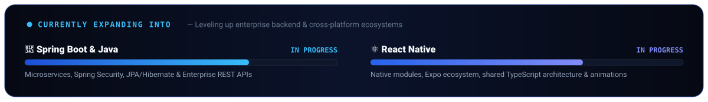

<!-- Custom Animated Hero Banner (Split Glassmorphism, Floating Terminal, Auroras & Waves) -->

 

<!-- Animated Typing Subheader -->

 

<!-- Clean Action Bar -->

  
  &nbsp;
  
  &nbsp;
  
  &nbsp;
  

 

 

<!-- Custom Animated Glassmorphic Bento Cards (What I Build) -->

  

 

 

## ✦ &nbsp; Tech Stack

 

<!-- Dark Rounded Tech Dock -->

  

<!-- Custom Animated Currently Expanding Into Card -->

 

 

## ✦ &nbsp; Consistency &amp; Contributions

 

<!-- GitHub Streak Stats (Black & Royal Blue) -->

  

<!-- Dark Mode Black & Blue Contribution Squares with Snake Animation (Auto-generated by .github/workflows/snake.yml) -->
<picture>
  <source media="(prefers-color-scheme: dark)" srcset="https://raw.githubusercontent.com/KennethBarreraDev/KennethBarreraDev/output/github-contribution-grid-snake-dark.svg" />
  <source media="(prefers-color-scheme: light)" srcset="https://raw.githubusercontent.com/KennethBarreraDev/KennethBarreraDev/output/github-contribution-grid-snake.svg" />
  
</picture>

 

 

### **Let's Build Something Great**

Open to high-impact engineering challenges, product collaborations, and technical conversations.

  

&nbsp;

  

<!-- Matching Animated Wave Footer SVG -->

