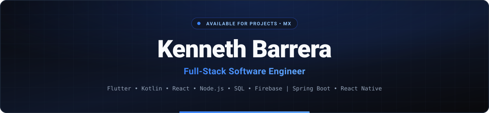

<div align="center">

<!-- Responsive Animated Wave SVG Banner (Scales cleanly on desktop & mobile) -->


<br/>

<!-- Animated Typing Subheader -->
<a href="https://github.com/KennethBarreraDev">
  
</a>

<br/>

<!-- Responsive Action Bar (Wraps naturally on mobile) -->
<p align="center">
  <a href="https://www.linkedin.com/in/kenneth-osvaldo-barrera-orozco-623578250/" target="_blank">
    
  </a>
  <a href="https://github.com/KennethBarreraDev" target="_blank">
    
  </a>
  
</p>

<br/>

<p align="center">
  <i>I design, architect, and ship <b>end-to-end digital products</b>—combining fluid mobile experiences, modern web interfaces, and scalable backend &amp; database systems.</i>
</p>

</div>

---

## ✦ &nbsp; What I Build

- **🌐 Full-Stack Web** — Fast, responsive web applications and scalable REST APIs built with `React`, `TypeScript`, `Node.js`, and `Express`.
- **📱 Mobile Engineering** — Fluid cross-platform and native Android apps engineered with `Flutter`, `Dart`, and `Kotlin` using Clean Architecture.
- **🗄️ Data & Cloud** — Normalized relational schemas, high-performance `SQL` (`MySQL`, `PostgreSQL`, `SQL Server`), and real-time serverless backends on `Firebase`.

---

## ✦ &nbsp; Engineering Profile

```ts
export const profile = {
  engineer:  "Kenneth Barrera",
  role:      "Full-Stack Software Engineer",
  location:  "Mexico 🇲🇽",

  coreStack: [
    "Flutter", "Kotlin",
    "React",   "Node.js",
    "SQL",     "Firebase",
  ],

  expandingInto: [
    "Spring Boot",
    "React Native",
  ],

  principles: [
    "End-to-End Ownership",
    "Clean Architecture & SOLID",
    "60/120fps Mobile & Fast SQL",
  ],
};
```

---

## ✦ &nbsp; Tech Stack

<div align="center">

<br/>

<!-- Responsive Wrapping Icons (Adapts automatically to desktop, tablet & mobile) -->
<p align="center">
  
  
  
</p>

<br/>

**⚡ Production Stack**

<p align="center">
  
  
  
  
  
  
  
  
  
  
  
  
</p>

<br/>

**🌱 Currently Expanding Into**

<p align="center">
  
</p>

<p align="center">
  <code>Spring Boot</code> · <code>Java</code> · <code>React Native</code>
</p>

</div>

---

## ✦ &nbsp; Consistency &amp; Contributions

<div align="center">

<br/>

<!-- GitHub Streak Stats (Black & Royal Blue) -->


<br/><br/>

<!-- Dark Mode Black & Blue Contribution Squares with Snake Animation -->
<picture>
  <source media="(prefers-color-scheme: dark)" srcset="https://raw.githubusercontent.com/KennethBarreraDev/KennethBarreraDev/output/github-contribution-grid-snake-dark.svg" />
  <source media="(prefers-color-scheme: light)" srcset="https://raw.githubusercontent.com/KennethBarreraDev/KennethBarreraDev/output/github-contribution-grid-snake.svg" />
  
</picture>

</div>

---

<div align="center">

### **Let's Connect**

<sub>Always happy to connect, talk software architecture, and share engineering ideas.</sub>

<br/><br/>

<p align="center">
  <a href="https://www.linkedin.com/in/kenneth-osvaldo-barrera-orozco-623578250/" target="_blank">
    
  </a>
  <a href="https://github.com/KennethBarreraDev" target="_blank">
    
  </a>
</p>

<br/>

<!-- Responsive Matching Animated Wave Footer SVG -->


</div>
